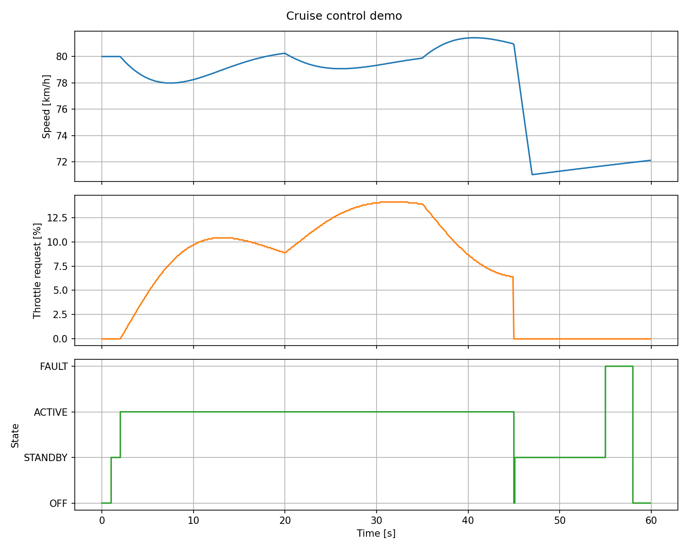
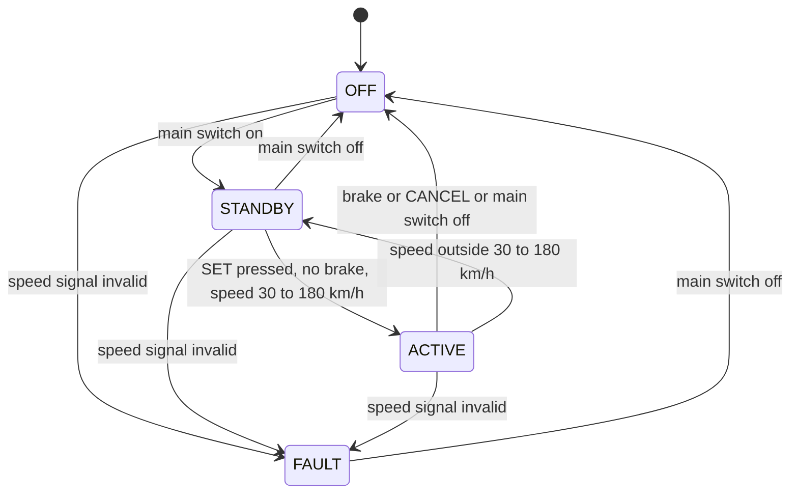

# Cruise Control ECU Module (C)


Cruise control software module in embedded-style C: a state machine, a PI speed
controller with anti-windup, and CAN signal packing (Intel and Motorola byte order).
It is developed requirements-first and verified with unit tests, static analysis,
code coverage and a CI pipeline.



*Demo scenario (60 s): activation at 80 km/h, 15 s uphill, brake at 45 s, speed
signal failure at 55 s.*

## Results

| Check | Result |
|---|---|
| Unit tests (Unity) | 39 tests, all passing |
| Line coverage of `src/` | 93.7 % (118 of 126 lines), 100 % of functions |
| Compiler warnings | `-Wall -Wextra -Wconversion -Wshadow -Wpedantic -Werror` on all production code |
| Static analysis | cppcheck (`--enable=all`, exhaustive), no findings |
| CI | GitHub Actions: build, tests, cppcheck, coverage gate at 90 % |

## Architecture

| Module | Responsibility |
|---|---|
| `src/pi_controller` | PI controller with output saturation and anti-windup |
| `src/cc_statemachine` | Cruise control logic: OFF, STANDBY, ACTIVE, FAULT |
| `src/can_signals` | Bit-level signal packing and unpacking in an 8-byte CAN frame, with scaling and range limiting |
| `src/main.c` | Demo: simple vehicle model, 10 ms cycle, CSV output |

Design rules: fixed-width types, no dynamic memory, no global variables. All state
lives in structs passed to the functions.

### State machine



In ACTIVE the PI controller holds the speed the vehicle had when SET was pressed.
The throttle request is limited to 0 to 100 %. Leaving FAULT needs a valid speed
signal and the driver switching the system off.

### CAN frame

| Signal | Start bit | Length | Byte order | Resolution |
|---|---|---|---|---|
| VehicleSpeed | 0 | 16 bit | Intel | 0.01 km/h |
| BrakePedal | 16 | 1 bit | Intel | 1 |
| ThrottleRequest | 24 | 8 bit | Intel | 0.5 % |

Example: 100 km/h, brake pressed, 50 % throttle gives `10 27 01 64 00 00 00 00`.

## Requirements and traceability

Requirements are in [docs/requirements.md](docs/requirements.md). Each one is
covered by at least one test.

| ID | Requirement | Test |
|---|---|---|
| REQ-01 | The system shall be in OFF state after start-up. | `test_REQ01_starts_in_off` |
| REQ-02 | The system shall enter ACTIVE when SET is pressed and the speed is between 30 and 180 km/h. | `test_REQ02_set_at_50_kmh_activates`, `test_REQ02_set_below_30_kmh_stays_standby`, `test_REQ02_set_above_180_kmh_stays_standby`, `test_REQ02_boundaries_30_and_180_are_accepted`, `test_REQ02_set_with_brake_pressed_does_not_activate` |
| REQ-03 | The system shall switch to OFF when the brake pedal is pressed. | `test_REQ03_brake_cancels_active` |
| REQ-04 | The system shall limit the throttle request to 0..100 %. | `test_REQ04_throttle_is_limited_to_100`, `test_REQ04_throttle_is_limited_to_0`, `test_REQ04_throttle_is_zero_when_not_active`, `test_output_is_clamped_to_max`, `test_output_is_clamped_to_min` |
| REQ-05 | The system shall enter FAULT if the speed signal is invalid. | `test_REQ05_invalid_speed_in_off_goes_to_fault`, `test_REQ05_invalid_speed_in_active_goes_to_fault` |
| REQ-06 | The system shall switch to OFF when CANCEL is pressed. | `test_REQ06_cancel_switches_active_to_off` |
| REQ-07 | The system shall leave ACTIVE if the speed drops below 30 km/h. | `test_REQ07_speed_below_30_leaves_active`, `test_speed_above_180_leaves_active` |
| REQ-08 | The system shall move from OFF to STANDBY when the main switch is on. | `test_main_switch_moves_off_to_standby` |
| REQ-09 | The system shall leave FAULT only when the speed signal is valid and the main switch is off. | `test_fault_stays_until_main_switch_is_turned_off` |
| REQ-10 | The system shall encode vehicle speed with 16 bits and a resolution of 0.01 km/h. | `test_CAN_known_frame_is_encoded_byte_by_byte`, `test_CAN_known_frame_is_decoded`, `test_CAN_speed_roundtrip_within_resolution` |
| REQ-11 | The system shall encode the throttle request with 8 bits and a resolution of 0.5 %. | `test_CAN_throttle_resolution_is_half_percent` |
| REQ-12 | The system shall limit signal values to the representable raw range. | `test_CAN_boundary_values_are_limited_to_raw_range` |
| REQ-13 | The system shall reject signal layouts that do not fit in the frame. | `test_CAN_invalid_layout_is_rejected_and_frame_unchanged` |

## Build and test

Requirements: `gcc`, `cmake`, `cppcheck`, `lcov` (on Ubuntu: `sudo apt install build-essential cmake cppcheck lcov`).

```bash
cmake -S . -B build
cmake --build build
ctest --test-dir build --output-on-failure
cmake --build build --target cppcheck
```

Run the demo and plot it:

```bash
./build/cruise_demo > cruise_demo.csv
python3 tools/plot_demo.py cruise_demo.csv
```

Coverage report (HTML in `build-cov/html`):

```bash
cmake -S . -B build-cov -DENABLE_COVERAGE=ON
cmake --build build-cov
ctest --test-dir build-cov --output-on-failure
lcov --capture --directory build-cov --output-file build-cov/coverage.info
lcov --extract build-cov/coverage.info "*/src/*" --output-file build-cov/coverage_src.info
genhtml build-cov/coverage_src.info --output-directory build-cov/html
```

## Project structure

```
src/        production code (pi_controller, cc_statemachine, can_signals, main)
test/       Unity unit tests, one file per module
docs/       requirements and demo plot
tools/      plot script for the demo output
.github/    CI workflow
```

## Limitations

- Runs on a PC with a simple vehicle model. No real hardware or RTOS yet.
- Speed hold only. There is no distance control to a vehicle ahead.
- 8 of 126 lines are not covered by tests yet (defensive code and error paths).
- Branch coverage has not been measured yet.

## Possible next steps

- Animated live plot and a 2D road view driven by the real C code (shared library called from Python)
- Branch coverage and MISRA C checks
- Adaptive cruise control with a lead vehicle
